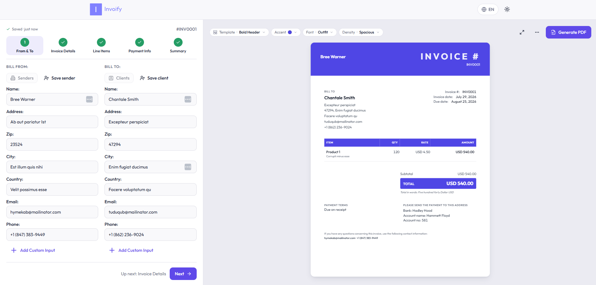
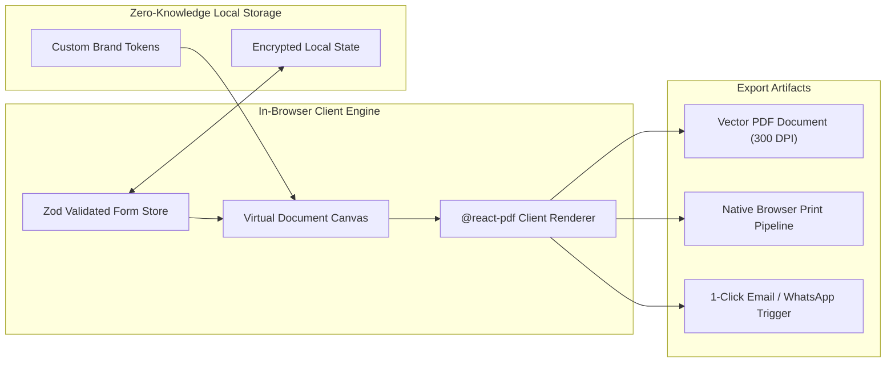

# Invoicraft Pro | Client-First Invoicing & Dynamic PDF Engine

[](https://nextjs.org)
[](https://www.typescriptlang.org)
[](https://react.dev)
[](https://ui.shadcn.com)
[](https://invoicraft.pro)

A precision-engineered, client-side billing application and dynamic PDF invoice generator. Built with **Next.js**, **TypeScript**, **shadcn/ui**, and **React PDF generation pipelines**, ensuring 100% data privacy with zero server storage overhead.

---

<div align="center">
  
</div>

---

## ⚡ Executive Summary & Client ROI

Businesses, contractors, and agencies need professional, compliant invoice generation without risking sensitive client fiscal data to third-party cloud aggregators. **Invoicraft Pro** executes dynamic, print-ready document rendering directly in the browser with real-time preview and instant PDF export.

| Metric | Target Achieved | Business Impact |
|---|---|---|
| **PDF Generation Speed** | **&lt; 200ms** | Instant in-browser binary compilation |
| **Data Privacy Compliance** | **100% GDPR/CCPA** | Zero data transmitted to external databases |
| **Export Quality** | **300 DPI Vector** | Pixel-perfect vector PDF printing & text search |
| **Operational Costs** | **$0 / month** | Fully static/edge hosting with zero database bills |

---

## 🚀 Key Engineered Features

- 🧾 **Live Interactive Document Canvas**: Split-view editor updating layout, line items, tax breakdowns, and discounts with sub-millisecond reactivity.
- 🎨 **Multi-Template Styling Engine**: Switch between Minimalist, Corporate, Modern Tech, and Classic fiscal styles without re-entering data.
- 🖨️ **Client-Side PDF Vector Pipeline**: Compiles vector PDF binaries with selectable text, clickable URLs, and embedded corporate branding directly on the client machine.
- 💱 **Global Multi-Currency & Tax Formats**: Supports ISO 4217 currencies, custom VAT/GST formulas, compound taxes, and international date localization.
- 💾 **Local Storage Persistence & Auto-Save**: Seamless state caching in browser memory, allowing users to safely refresh or resume drafting at any time.
- 📱 **Responsive Mobile Invoicing**: Fully optimized for smartphone generation and 1-tap WhatsApp or Email sharing on the go.

---

## 🏛️ System Architecture



---

## 🛠️ Complete Tech Stack

* **Framework**: [Next.js](https://nextjs.org/) (App Router, Static Export Capability)
* **Language**: [TypeScript](https://www.typescriptlang.org/) (Strict typing, Zod schema validation)
* **UI & Primitives**: [shadcn/ui](https://ui.shadcn.com/) built on [Radix UI](https://www.radix-ui.com/)
* **Styling**: [Tailwind CSS](https://tailwindcss.com/)
* **Document Engine**: `@react-pdf/renderer` & HTML5 Canvas
* **State Management**: React Context + LocalStorage Persistence

---

## 🏁 Quick Start & Local Setup

```bash
# 1. Install dependencies
pnpm install

# 2. Run local development server
pnpm dev
```
Open [http://localhost:3000](http://localhost:3000) to start generating invoices.

---

## 👨‍💻 Engineering Lead & Contract Inquiries

Architected and maintained by **Niall.M** — Senior Webmaster, Principal Frontend Engineer & E-Commerce Architect.

* 🌐 **GitHub**: [github.com/niallmuk](https://github.com/niallmuk/)
* 📧 **Email**: [niall@nialluk.com](mailto:niall@nialluk.com)
* 💬 **Telegram**: [@nialluk](https://t.me/nialluk)
* 📱 **WhatsApp**: [+44 7446317825](https://wa.me/447446317825)
* 💼 **Contra Profile**: *Available for bespoke fintech tooling, client-side document engines, and SaaS products.*
